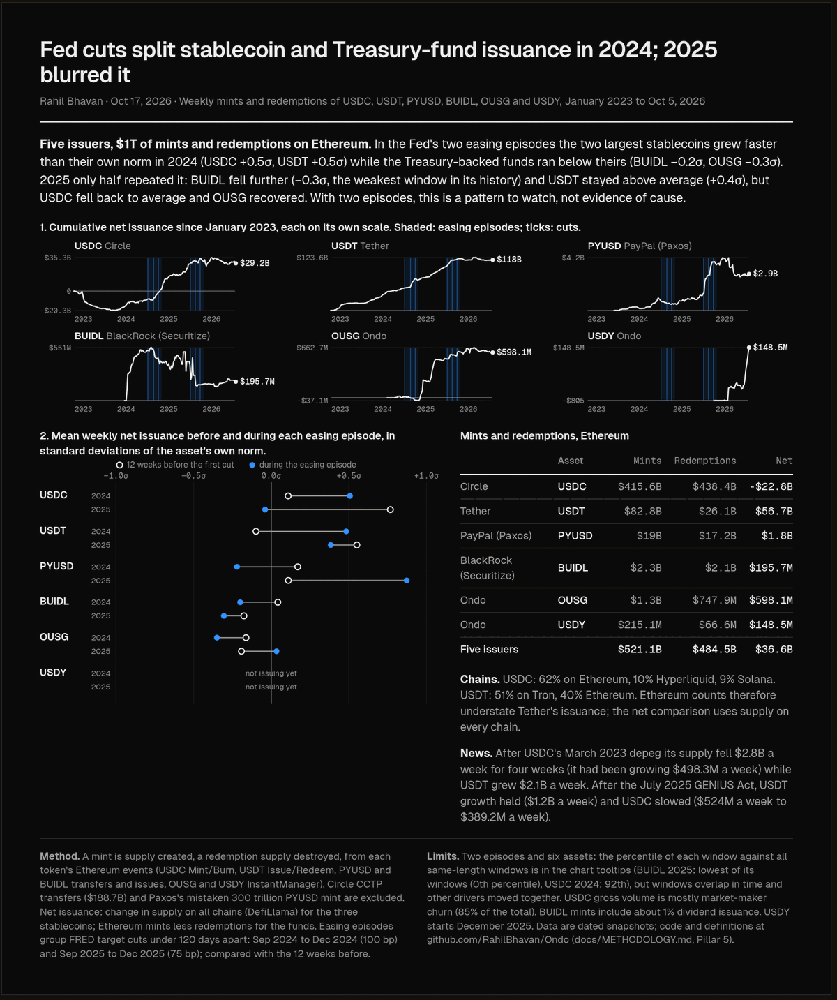

# Ondo flows dashboard: OUSG, USDY and stablecoin mints and redemptions from Ethereum logs

[](https://github.com/RahilBhavan/Ondo/actions/workflows/ci.yml)
[](LICENSE)

**Live:** [ondo-nexus.vercel.app](https://ondo-nexus.vercel.app)



A Next.js dashboard that decodes Ondo's OUSG and USDY InstantManager events on Ethereum and charts weekly mint volume, redeem volume, net flow and unique wallets. The `/issuance` page puts the same measurement on six assets from five issuers: USDC (Circle), USDT (Tether), PYUSD (PayPal), BUIDL (BlackRock) and OUSG and USDY (Ondo). It also shows where each stablecoin's supply sits by chain and how net issuance moved around the Fed's rate cuts. Every number on the page carries a **live**, **estimated** or **mocked** badge.

## Results

From the dated snapshot in `src/data/issuance.json` (event logs read 2026-10-24, Ethereum only, weeks of 26 Dec 2022 through 12 Oct 2026):

| Asset | Mints | Redemptions | Net |
|-------|------:|------------:|----:|
| USDC | $420.5B | $444.2B | −$23.7B |
| USDT | $82.8B | $26.1B | $56.7B |
| PYUSD | $19.2B | $17.3B | $1.8B |
| BUIDL | $2.3B | $2.1B | $195.9M |
| OUSG | $1.3B | $748.5M | $598.5M |
| USDY | $250.1M | $68.8M | $181.3M |
| **Five issuers** | **$526.3B** | **$490.5B** | **$35.8B** |

- The snapshot holds 3,212,656 decoded event logs (the `audit` counts in `src/data/issuance.json`). USDC is 3.17M of them.
- $192.1B of USDC mints and burns are Circle CCTP transfers between chains. The tracker excludes them because moving USDC between chains is not new money. It also excludes Paxos's mistaken 300 trillion PYUSD mint and its burn on 2025-10-15.
- In the 2024 easing episode (Sep to Dec 2024, 100 bp), USDC and USDT net issuance ran above their own norm (+0.5σ each), and BUIDL and OUSG ran below theirs (−0.2σ and −0.3σ). The 2025 episode (Sep to Dec 2025, 75 bp) only partly repeated it. With two episodes this is descriptive, not evidence of cause. `/summary` renders these figures from `src/lib/issuance.ts`.
- Ethereum log-derived net issuance matched DefiLlama's Ethereum supply change within 17% for USDC and 7% for PYUSD (`src/lib/issuance.check.ts`, run 2026-10-24).

## How it works

- **Ondo flows (`/`, `/flows`).** `src/lib/flowEvents.ts` pages the InstantManager logs from Blockscout's keyless v2 API, decodes them with viem and groups them by Monday-UTC week. It reads three contracts: the current OUSG manager, the legacy OUSG manager (Apr 2024 to Apr 2025) and the USDY manager. Log pages older than a fixed block cache for a week. Newer pages refresh hourly. `queries/mint_redeem_volume.sql` holds the same definition in Dune SQL as a written reference.
- **Home page pillars.** `src/lib/chainSupply.ts` reads total supply on 13 chains and prices it with the Ethereum `OndoOracle`. `src/lib/topHolders.ts` reads Ethereum holders from Blockscout. `src/lib/benchmark.ts` reads BUIDL from DefiLlama's stablecoin series and the Ondo row from the on-chain total; Superstate and OpenEden TVL have no free live source and stay labeled snapshots. When a source fails, each getter returns a dated, labeled snapshot from `src/lib/mockData.ts`.
- **Stablecoin flows (`/issuance`, `/summary`).** `scripts/backfill-issuance.mjs` reads `eth_getLogs` from Tenderly's public mainnet gateway in 100,000-block windows. `scripts/backfill-context.mjs` adds DefiLlama supply by chain and the FRED `DFEDTARU` rate. Both scripts write `src/data/*.json`. The pages read these snapshots through `src/lib/issuance.ts`, not on each request.
- `/api/metrics` returns the same data as JSON.

## Run it

Prerequisites: Node.js 20 or later (CI uses 20) and npm. No API keys are needed. Every data source is public and keyless.

```bash
npm ci
npm run lint
npx tsc --noEmit
npm test
npm run dev        # http://localhost:3000
```

`npm test` runs the seven self-check scripts in `src/lib/*.check.ts` with `tsx` (pinned in `package.json`). They need no network. `issuance.check.ts` reconciles the committed snapshots. CI runs lint, the type check, `npm test` and `npm run build`.

To refresh the stablecoin snapshots (about 25 minutes on the free public RPC), then rebuild the study guide:

```bash
node scripts/backfill-issuance.mjs
node scripts/backfill-context.mjs
npx tsx src/lib/issuance.check.ts
npx tsx docs/textbook/build.ts
```

The USDC share card (`docs/img/usdc-share-card.svg` and `.png`, 1024px wide, navy and red) is built from the same snapshot. On posting day run `npm run card:usdc-share:fresh`: it re-pulls the event logs, then renders the card with its data-as-of date. `npm run card:usdc-share` renders from the existing snapshot and refuses one that is not from today (`--allow-stale` overrides).

## Repository layout

```
src/app/          Pages (/, /flows, /issuance, /summary) and /api/metrics
src/components/   Dashboard charts, issuance figures and UI atoms
src/lib/          Data getters, types, mock fallbacks and *.check.ts self-checks
src/data/         Dated snapshots for the stablecoin flows tracker
scripts/          Backfill scripts that write src/data/*.json
queries/          Metric definitions in Dune SQL (reference; the app does not call Dune)
docs/             Methodology, contract research, decisions and the study guide
.claude/          Claude Code agents, commands and the live-pillar skill
```

`.mcp.json` connects the Dune MCP server for ad hoc SQL and reads `DUNE_API_KEY` from your environment. The app does not use it.

## Documentation

- [docs/METHODOLOGY.md](docs/METHODOLOGY.md): how each number is sourced, computed and labeled, pillar by pillar.
- [docs/CONTRACT_RESEARCH.md](docs/CONTRACT_RESEARCH.md): Ondo contract addresses, event schemas and why Ondo Nexus has no contracts of its own.
- [docs/DECISIONS.md](docs/DECISIONS.md): architecture decision records, from Dune to Blockscout logs to precomputed snapshots.
- [docs/BLOCKERS.md](docs/BLOCKERS.md): open blockers and how past ones were resolved.
- [docs/textbook/index.html](docs/textbook/index.html): a printable study guide to the stablecoin flows tracker, built from the same snapshots.

## Sources

- **Ondo flows.** InstantManager event logs from [Blockscout](https://eth.blockscout.com) (v2 API, keyless), read at render time and cached for one hour. Full history from Apr 2024 (OUSG) and Dec 2025 (USDY).
- **Chain supply and price.** public RPCs and chain APIs on 13 chains, priced with `OndoOracle` on Ethereum. The per-chain table is in [docs/METHODOLOGY.md](docs/METHODOLOGY.md).
- **Holders.** Blockscout token holders API, Ethereum only.
- **Benchmark.** [DefiLlama](https://defillama.com) TVL per product, plus redemption terms quoted from each issuer's docs.
- **Stablecoin flows.** Ethereum event logs through Tenderly's public gateway, DefiLlama stablecoin supply and FRED `DFEDTARU`. The backfill scripts freeze these as dated JSON in `src/data/`, with `asOf` 2026-10-24.
- Fallback snapshots in `src/lib/mockData.ts` carry their own source and date.

## Scope and limits

- Independent project. It is not affiliated with or endorsed by Ondo Finance, Circle, Tether, PayPal, Paxos, BlackRock or Securitize.
- Ondo Nexus has no contracts of its own. The dashboard uses OUSG and USDY InstantManager activity as its on-chain proxy ([ADR-003](docs/DECISIONS.md)).
- It counts instant mints and redemptions only. Secondary transfers, DEX trades and bridged balances are out of scope.
- Gross flows are Ethereum only. Tron holds about half of USDT supply, so Ethereum logs understate USDT and USDC issuance. Net issuance for the three stablecoins uses all-chain supply instead.
- The stablecoin data are a snapshot from 2026-10-24. It is stale until someone reruns the backfill scripts.
- The rate-cut comparison covers two easing episodes, so it is descriptive only.
- On 2026-10-21, DefiLlama's `/tvl/<slug>` endpoint returned `0` for all four benchmark products. The competitor rows therefore show the 2026-09-24 snapshot, labeled **mocked**.

## License

[MIT](LICENSE). The license covers this project's code, not third-party data from Blockscout, DefiLlama, FRED or the issuers.

Part of [Rahil Bhavan's projects](https://github.com/RahilBhavan).
